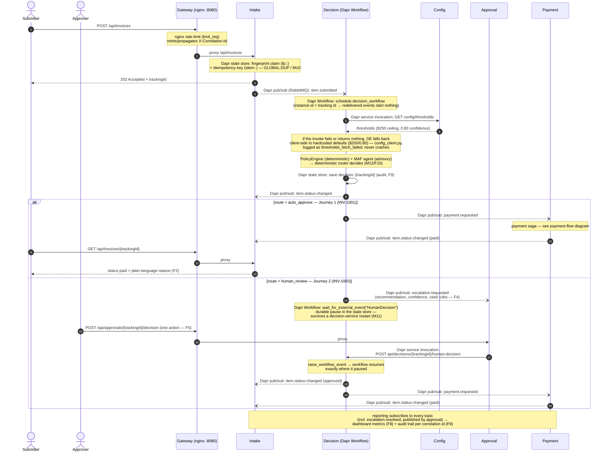
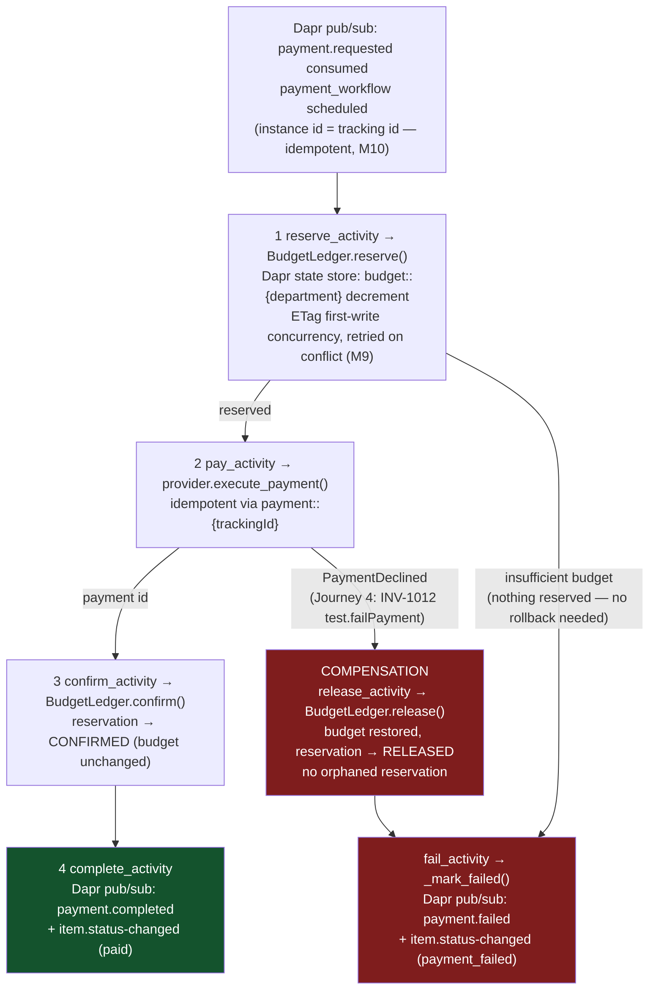

# ApprovalFlow — Invoice & Expense Approval Platform

Microservice-based, AI-assisted platform that automates invoice and expense approvals:
an AI agent judges each item against the company policy and **recommends**; a
**deterministic router decides**. The simple, low-risk majority is auto-approved under a
provable autonomy ceiling; unclear, risky, or high-value items are escalated to a human.
Approved items run through a compensating payment saga. Every decision is fully auditable
via one correlation id.

Capstone for the **Microservice Architecture** and **AI Engineering** courses.

> 🚧 Work in progress — built in staged pull requests. See the PR history for the
> requirement-by-requirement trail. Current: **all four worked journeys are green
> end-to-end** via `tools/verify.py` (9/9): auto-approve→paid, escalate-and-resume
> (surviving a decision-service restart), duplicate short-circuit, and payment
> failure + compensation — plus the anti-cheese guards and the gateway check.

## Tech stack

- **Python 3.12 + FastAPI + Pydantic** — all services
- **Microsoft Agent Framework (Python)** — the decisioning agent (structured output only)
- **Dapr 1.18** — service invocation, pub/sub, state, config, secrets, **Workflow** (saga + durable HITL)
- **RabbitMQ** — message broker behind Dapr pub/sub
- **Redis** — per-service state stores + Dapr configuration store
- **nginx** — API gateway (single entry point, rate limiting) + serves the UI
- **React + Vite** — minimal UI
- **Ollama + Qwen** (default) / Groq / Gemini / deterministic stub — LLM provider, swappable by config

## Run locally

```bash
cp .env.example .env   # adjust if desired
docker compose up
```

Everything — services, gateway, queue, databases, Dapr sidecars — comes up with that one
command. The UI is served at <http://localhost:8080>.

## Verify

A single command runs the four acceptance journeys (auto-approve, escalate-and-resume,
duplicate, payment failure + compensation) plus the anti-cheese guards, and prints
pass/fail:

```bash
python tools/verify.py    # uses the deterministic stub model — no rate limits
```

## Test

```bash
pip install -r requirements-dev.txt
ruff check .
pytest
```

## System diagrams

Canonical source: [`docs/ARCHITECTURE.md`](docs/ARCHITECTURE.md) — the blocks
below are copied **verbatim** from there (edit there first, then re-copy, so
the two can never drift apart).

### Journeys 1 & 2 — submit → decide → (auto-approve | escalate-and-resume)

<!-- diagram source of truth: docs/ARCHITECTURE.md — copied verbatim into README.md -->


### Payment flow — saga with compensation (Journey 4, INV-1012)

<!-- diagram source of truth: docs/ARCHITECTURE.md — copied verbatim into README.md -->


## Repository layout

```
services/    FastAPI microservices (one folder per service) + shared library
gateway/     nginx gateway (UI + API entry point, rate limiting)
ui/          React + Vite frontend
dapr/        Dapr component definitions (pub/sub, state, config)
tools/       verification command + helpers
tests/       unit / integration tests
docs/        ARCHITECTURE.md, ADRs, product dilemma
Examples/    course-shipped fixtures: policy.md, sample-invoices.json
Documents/   assignment + course material
```

## License

[MIT](LICENSE)
