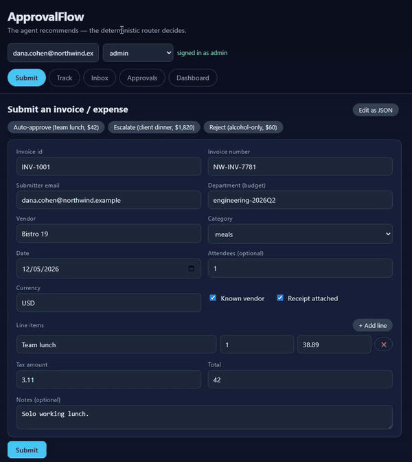
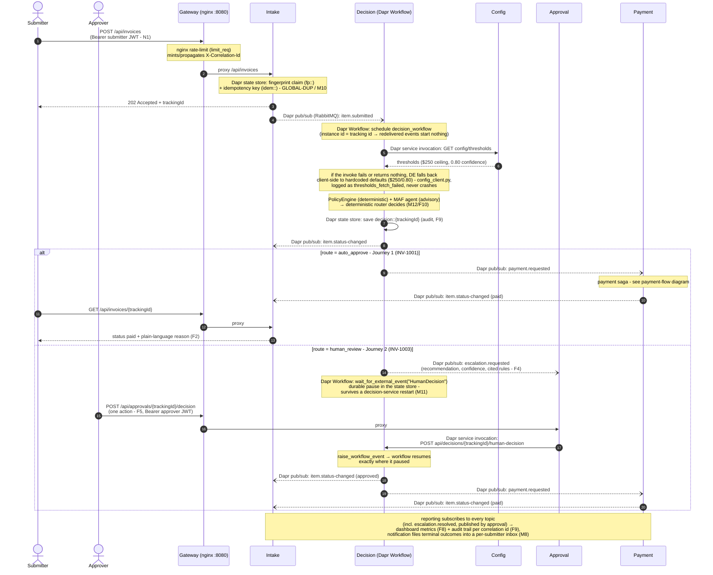

# ApprovalFlow - Invoice & Expense Approval Platform

Microservice-based, AI-assisted platform that automates invoice and expense approvals:
an AI agent judges each item against the company policy and **recommends**; a
**deterministic router decides**. The simple, low-risk majority is auto-approved under a
provable autonomy ceiling; unclear, risky, or high-value items are escalated to a human.
Approved items run through a compensating payment saga. Every decision is fully auditable
via one correlation id.

Capstone for the **Microservice Architecture** and **AI Engineering** courses.

## Application demo

[](docs/assets/application-demo.mp4?raw=1)

[▶ Watch the full demo recording with audio (Google Drive)](https://drive.google.com/file/d/15M5egWcrvz94Md_I2aNZgjyzd7ovGngi/view?usp=sharing)

> Built in staged pull requests - see the PR history for the
> requirement-by-requirement trail. **All four worked journeys are green
> end-to-end** via `tools/verify.py` (11/11): auto-approve→paid, escalate-and-resume
> (surviving a decision-service restart), duplicate short-circuit, and payment
> failure + compensation - plus the anti-cheese guards, the gateway check,
> inbox delivery, and the auth (401/403) checks.

## Tech stack

- **Python 3.12 + FastAPI + Pydantic** - all services
- **Microsoft Agent Framework (Python)** - the decisioning agent (structured output only)
- **Dapr 1.18** - service invocation, pub/sub, state, config, secrets, **Workflow** (saga + durable HITL)
- **RabbitMQ** - message broker behind Dapr pub/sub
- **Redis** - per-service Dapr state stores (thresholds served by the config service, runtime-changeable)
- **nginx** - API gateway (single entry point, rate limiting) + serves the UI
- **React + Vite** - UI: form-based submission, live tracking with an audit
  timeline, approval queue, inbox, dashboard
- **Ollama + Qwen** (default) / Groq / Gemini / OpenAI / deterministic stub - LLM provider, swappable by config

## Run locally

```bash
cp .env.example .env   # adjust if desired
docker compose up
```

Everything - services, gateway, queue, databases, Dapr sidecars - comes up with that one
command. The UI is served at <http://localhost:8080>.

## Auth (N1)

User-facing API endpoints require a **self-signed role JWT** (roles:
`submitter` / `approver` / `admin`; admin passes every gate). The UI signs in
automatically via the role picker in the header; API clients trade a user+role
for a token first:

```bash
curl -s -X POST http://localhost:8080/api/auth/token \
  -H 'Content-Type: application/json' \
  -d '{"user":"dana.cohen@northwind.example","role":"submitter"}'
# → {"token":"...", ...}   then:  Authorization: Bearer <token>
```

Role map: submit needs `submitter`; the approval queue, decisions, budgets and
the dashboard need `approver`; the audit trail needs `admin`. Dapr-internal
surfaces (pub/sub handlers, service invocation, health checks) are not exposed
through the gateway and stay token-free. The issuer is a dev-grade stub
(HS256, secret in `AUTH_SECRET`) - production would swap in a real identity
provider without touching the route guards.

## Using the UI

The UI at <http://localhost:8080> has five tabs; the role picker in the header
signs you in (see [Auth](#auth-n1)):

- **Submit** - a form mirroring the invoice schema (line items, category,
  receipt flag, …) with one-click sample pre-fills; an **Edit as JSON** toggle
  posts a raw fixture as-is (handy for the `test.failPayment` demo hook).
  Accepted items return a tracking id and jump straight to Track.
- **Track** - live status and plain-language reason for one tracking id; with
  the `admin` role it also renders the full audit trail as a timeline
  (submitted → decision → human review → paid / failed).
- **Inbox** - final outcomes for a submitter email (M8).
- **Approvals** - the escalation queue (needs `approver`): each card shows the
  agent's recommendation, confidence, and cited policy rules; approve / reject /
  send back in one action (F5), with an optional note recorded to the audit
  trail. Decisions are attributed to the signed-in user.
- **Dashboard** - throughput and autonomy metrics (needs `approver`).

## Verify

A single command runs the four acceptance journeys (auto-approve, escalate-and-resume,
duplicate, payment failure + compensation) plus the anti-cheese, gateway, inbox, and
auth guards - 11 checks - and prints pass/fail:

```bash
python tools/verify.py    # uses the deterministic stub model - no rate limits
```

## Test

```bash
pip install -r requirements-dev.txt
ruff check .
pytest
```

## CI / CD

CI runs the quality gates (ruff + pytest) and the end-to-end verification on
every push. On a green `main`, the CD stage automatically builds and publishes
all service images to GHCR as `ghcr.io/<owner>/approvalflow-<service>`,
tagged with the commit SHA - no manual release step (N2). The mutable `latest`
tags are promoted in a follow-up job only after **every** image published
successfully (and only if the commit is still the head of `main`), so `latest`
always describes one tested commit, never a mixed-version release.

## System diagrams

Canonical source: [`docs/ARCHITECTURE.md`](docs/ARCHITECTURE.md) - the blocks
below are copied **verbatim** from there (edit there first, then re-copy, so
the two can never drift apart).

### Journeys 1 & 2 - submit → decide → (auto-approve | escalate-and-resume)

<!-- diagram source of truth: docs/ARCHITECTURE.md - copied verbatim into README.md -->


### Payment flow - saga with compensation (Journey 4, INV-1012)

<!-- diagram source of truth: docs/ARCHITECTURE.md - copied verbatim into README.md -->


## Repository layout

```
services/    FastAPI microservices (one folder per service) + shared library
gateway/     nginx gateway (UI + API entry point, rate limiting)
ui/          React + Vite frontend
dapr/        Dapr component definitions (pub/sub, state, secrets)
tools/       verification command + helpers
tests/       unit / integration tests
docs/        ARCHITECTURE.md, ADRs, product dilemma
Examples/    course-shipped fixtures: policy.md, sample-invoices.json
Documents/   assignment + course material
```

## License

[MIT](LICENSE)
