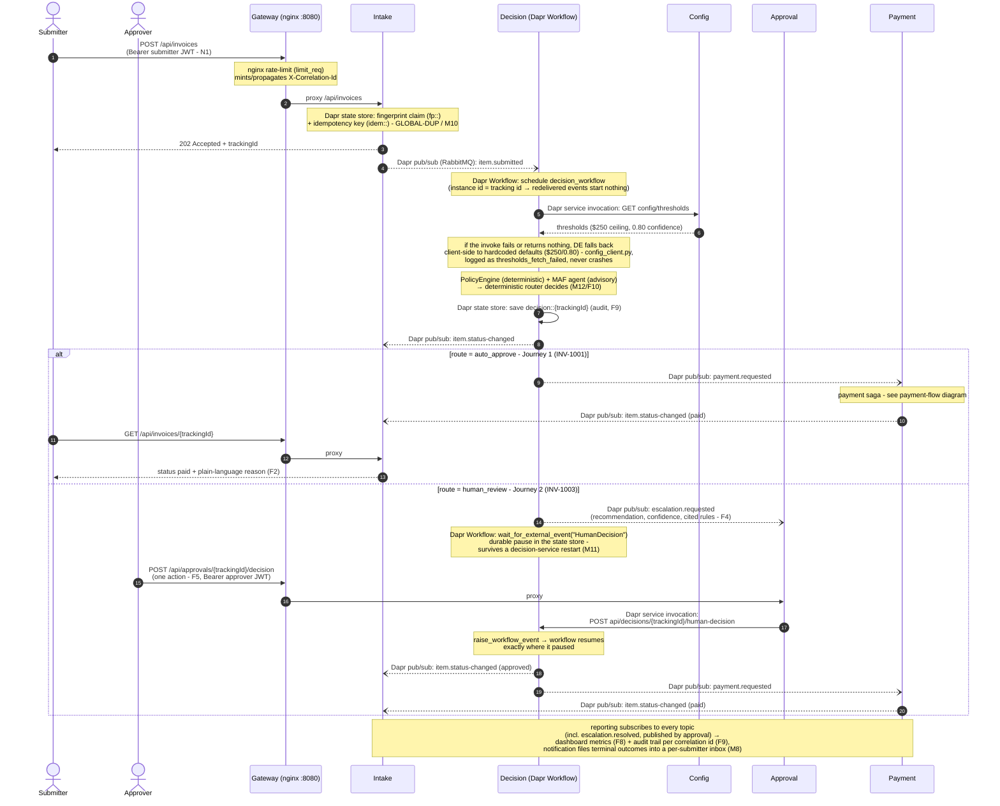
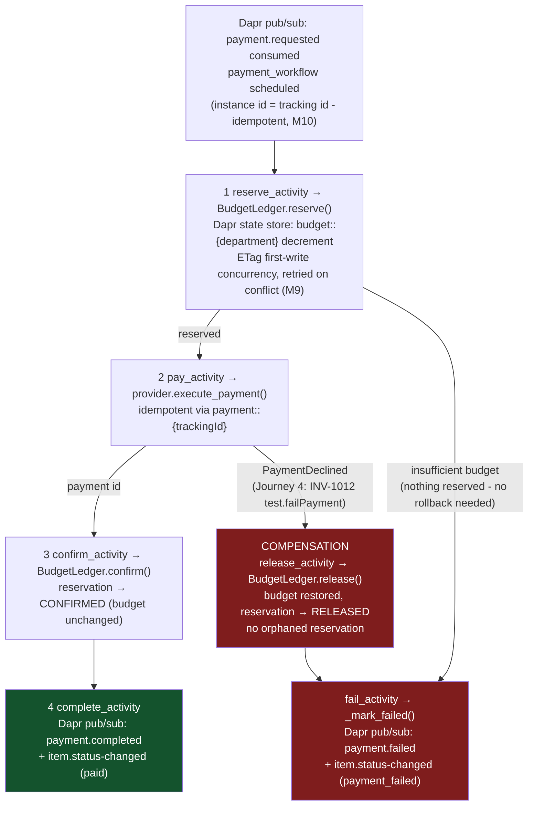

# ApprovalFlow - Architecture (D1)

This document holds the two canonical diagrams required by D1: the end-to-end
**sequence diagram** (Journey 1 auto-approve and Journey 2 escalate-and-resume,
branching at the router's decision) and the **payment-flow diagram** (Journey 4)
showing each saga step and its compensation.

> The same two Mermaid blocks are embedded verbatim in [README.md](../README.md)
> (marked with `diagram source of truth` comments). **Edit them here first, then
> copy the block verbatim into the README** so the two can never drift apart.

Every step below maps to real code - service names, topics, state keys, and
function names are the ones in the repo. Each arrow is labeled with the Dapr
building block it uses (service invocation, pub/sub over RabbitMQ, state store,
Workflow). The nginx gateway is the single external entry point (M6); one
correlation id - the tracking id - follows the request end-to-end (M14/F9).
User-facing calls carry a role JWT (N1) - submitting needs `submitter`, working
the queue needs `approver`, the audit trail needs `admin` - enforced by
`require_role` in each owning service; the gateway proxies only user-facing
routes, and Dapr-internal surfaces (pub/sub handlers, service invocation) are
never exposed through it.

## Journeys 1 & 2 - submit → decide → (auto-approve | escalate-and-resume)

<!-- diagram source of truth: docs/ARCHITECTURE.md - copied verbatim into README.md -->

## Payment flow - saga with compensation (Journey 4, INV-1012)

Orchestrated by `payment_workflow` in
`services/payment/approvalflow_payment/workflow.py`; budget logic in
`budget.py` (`BudgetLedger`), provider in `provider.py`. Department budgets are
updated with ETag first-write concurrency so two concurrent approvals can never
overspend (INV-1014A/B). Every activity is idempotent (M10).

<!-- diagram source of truth: docs/ARCHITECTURE.md - copied verbatim into README.md -->

## Reading the diagrams against the requirements

| Requirement | Where it appears above |
|---|---|
| M6 single entry + rate limit | Gateway participant, first note |
| M8 async intake + notify | `202 + trackingId` before any processing; notification files terminal outcomes into the submitter's inbox (final note) |
| M9 compensation | red `release_activity` path - budget restored, then `payment_failed` |
| M10 idempotency | fingerprint/idempotency claims at intake; workflow instance id = tracking id; idempotent saga activities |
| M11 durable HITL | `wait_for_external_event` note - the pause survives a decision-service restart (proven by `tools/verify.py` Journey 2, which restarts the container between pause and resume) |
| M12/F10 provable ceiling | router note - the deterministic router decides; the agent is advisory |
| M14/F9 correlation | gateway mints/propagates `X-Correlation-Id` = tracking id; decision record + reporting audit trail keyed by it |
| F4/F5 | escalation payload carries recommendation/confidence/cited rules; one-action approve/reject/send-back |
| N1 role JWT auth | Bearer tokens on the submit/approve arrows; `require_role` guards live in each service, not the gateway - Dapr-internal surfaces stay unexposed |
