# Architecture walkthrough

Walked in **request order**, not alphabetical - the order that lands the
deterministic core before anyone's asked "wait, where's the AI actually
involved."

## The diagram

```mermaid
flowchart LR
    U[Submitter / Approver] -->|HTTP, JWT| GW[Gateway<br/>nginx :8080<br/>rate limit + correlation id]

    GW --> IN[Intake<br/>validate, dedupe, 202 + tracking id]
    IN -->|item.submitted| BUS[(RabbitMQ<br/>pub/sub)]

    BUS --> DEC[Decision<br/>PolicyEngine + AI Agent + route&#40;&#41;<br/>Dapr Workflow]
    CFG[Config<br/>thresholds: $250 / 0.80] -.serves.-> DEC

    DEC -->|auto/reject/duplicate| BUS
    DEC -->|escalation.requested| APR[Approval<br/>human queue]
    APR -->|resumes paused workflow| DEC

    DEC -->|payment.requested| BUS
    BUS --> PAY[Payment<br/>saga: reserve→pay→confirm<br/>+ compensation]

    BUS --> REP[Reporting<br/>metrics + audit trail]
    BUS --> NOT[Notification<br/>per-submitter inbox]

    style DEC fill:#f9e79f,stroke:#b7950b,color:#000000
    style PAY fill:#aed6f1,stroke:#2874a6,color:#000000
```

## The walkthrough, stop by stop

**1. Entry point - the gateway.** Everything external hits nginx on 8080.
It's the *only* thing reachable from outside; every backend service is
bound to `127.0.0.1` only. It rate-limits, stamps a correlation id if one
isn't already present, and proxies by path prefix - it never touches a JWT,
so authorization logic lives in exactly one place (each service), not two.

**2. Intake - the front door that never waits.** `POST /api/invoices`
validates, checks two independent dedup keys (an idempotency key and a
content fingerprint), persists, publishes `item.submitted`, and returns 202
in milliseconds - before the AI agent has even been asked anything. That's
deliberate: submission must never block on how slow the model or a human
approver turns out to be.

**3. Decision - the one place AI output gets near a money decision.** This
is the core of the talk. Three parts work together here:
   - The **policy engine** - a pure, deterministic function that checks hard
     stops (fraud signals, missing receipts, math that doesn't reconcile,
     unknown vendors, FX limits) against `Examples/policy.md`'s rules.
   - The **AI agent** - reads the invoice (as *data*, never as instructions -
     that's the prompt-injection defense) and produces a confidence score and
     a recommendation.
   - The **router** - a ~100-line pure function with no I/O. It reads
     exactly one field off the agent's output - `confidence` - and only ever
     uses it to *downgrade* toward a human. It never reads
     `recommendation`. Auto-approve is reachable only through the one branch
     where every other condition already passed.
   All of this runs inside a **Dapr Workflow**, so the two shapes of the
   decision - straight-through, or pause-and-wait-for-a-human - are the same
   durable orchestration; killing the container mid-pause and restarting it
   doesn't lose the wait.

**4. Config - thresholds without a redeploy.** Decision asks config for the
current ceiling ($250) and confidence floor (0.80) on every run. If config
is unreachable, decision falls back to hardcoded defaults matching the same
numbers - fails safe, never fails open, never silently loosens past what
shipped.

**5. Approval - the human queue.** Only items decision couldn't safely
clear land here - an approver structurally cannot rubber-stamp something the
router was willing to handle itself. One click resolves the paused workflow
exactly once, even under retries or two approvers racing the same item.

**6. Payment - the ledger, choreographed not orchestrated.** Both the
auto-approve path and the human-approved path publish the same
`payment.requested` event; payment doesn't know or care which one fired it.
It's a saga - reserve budget, pay, confirm - with a compensating release if
the payment step fails, so a declined payment can never leave a debited
budget with nothing to show for it.

**7. Reporting and notification - the two consumers that just watch.**
Reporting builds the cross-cutting audit trail and dashboard metrics;
notification delivers only *terminal* outcomes to a per-submitter inbox.
Neither publishes anything back - pure sinks, watching the same event
stream for different reasons.

## The core idea

*"An AI agent recommends; a deterministic function decides - and that
function only ever reads one number off the agent's output, only to make
things stricter, never to approve something itself."*
